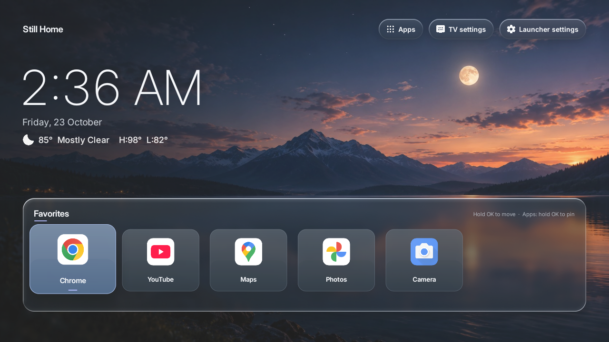
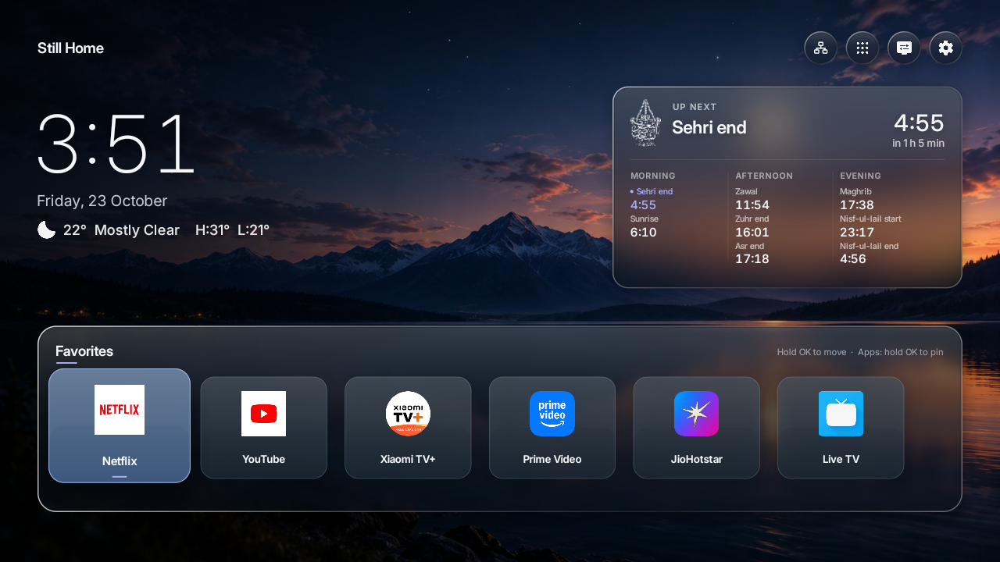
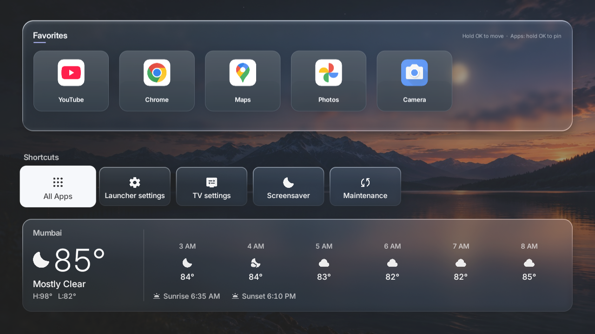
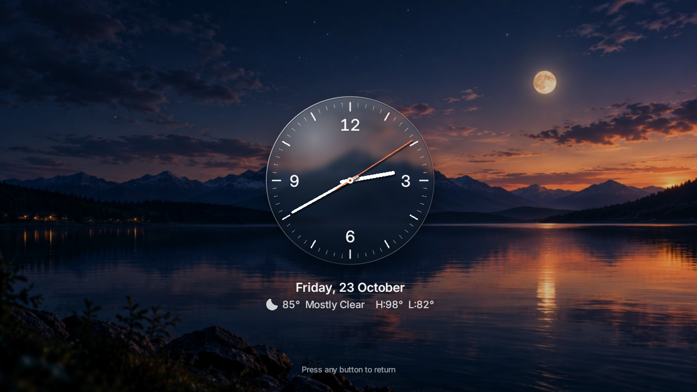

# Still Home

A small, MIT-licensed Android TV launcher built for a Redmi `MiTV-AXFR0`. It has one remote-friendly Favorites shelf, a drawer with the weather and shortcuts, a full installed-app sheet, personal wallpapers or a live aurora, and a glass-clock screensaver. The app has **no ads, no analytics, no accounts and no runtime libraries**. Its only network use is the weather forecast for the city you choose (Open-Meteo, no key), and that can be switched off.



Version 0.3 keeps the look of the original home screen (the dusk lake wallpaper, the thin clock, the three glass pills and the Favorites shelf) and draws it the way [Free My TV](https://github.com/simbasjungles/free-my-tv) draws its home screen: by hand on one Canvas, with spring animations, glass that shows the blurred wallpaper through it with a lit rim, and nothing redrawn while nothing moves. Large parts of that rendering and interaction code are lifted from Free My TV under the MIT license; see [THIRD_PARTY.md](THIRD_PARTY.md).

## What works

- **Home.** The wordmark, the clock and date, and the weather line for your city (temperature, conditions, high and low). Top right, four icon-only glass discs: the network (Wi-Fi or Ethernet, and whether the TV is online: amber without internet, a red slash when not connected; OK opens the TV's network settings), All apps, the TV's Android settings and Launcher settings. The focused disc turns white, grows a little and slides its name out beside the icon.
- **Namaz times.** A glass card opposite the clock with the owner's emblem, the coming time (name, hour, how long until it) and the whole day in three columns: Morning (Sihori end, Sunrise), Afternoon (Zawal, Zuhr end, Asr end) and Evening (Maghrib, Nisf-ul-lail start and end). Worked out from the sun at your city, no network, following the owner's timetable: Sihori end is 75 minutes before sunrise, Zawal the sun's highest point, the time from Zawal to sunset is split in three (Zuhr ends at the first third, Asr at the second), Maghrib is sunset, and Nisf-ul-lail starts at true midnight (Zawal plus twelve hours) and lasts one hour of the night (a twelfth of the night). The card can be hidden in Launcher settings.

  

- **Favorites.** The pinned apps on a glass shelf; the focused tile rises with a spring. Hold OK on a tile to move it (← → move, OK drops, Back cancels). In **All apps**, hold OK on an app to pin or unpin it. Up to 8 favorites; the default list is the installed streaming apps.
- **Drawer.** Press ↓ on the shelf: everything lifts and a drawer appears with the TV's inputs (when it has any), shortcuts (All apps, Launcher settings, TV settings, Screensaver, Maintenance) and the weather card: now, the next six hours, sunrise and sunset. ↑ or Back closes it.

  

- **All apps.** A sheet of 16:9 cards with each app's TV art. Pinned apps are marked in the accent color.
- **Backgrounds.** Dusk lake, Horizon, Stone, a photo sent from your computer, or the **live aurora**, whose colors follow the real sunrise and sunset at your city (and which can be told to hold still on Home).
- **Screensaver.** An analog glass clock whose second hand sweeps continuously, with the date and weather under it, over your wallpapers slowly zooming and cross-fading every 30 seconds (or over the aurora). A digital style is available too. The clock drifts slowly so no pixel stays lit.

  

- **Launcher settings.** Background, aurora motion, weather on/off, city (searched through Open-Meteo's geocoding), °C/°F, 12/24-hour clock, screensaver style and background, click sounds, language (the Free My TV catalogues: Hindi, Portuguese, Spanish, German, French, Japanese and more), favorites reset, Home role and Maintenance.
- **Maintenance.** Storage and memory information, system storage settings, each app's Android App info screen, and "Clear launcher cache", which only clears Still Home's own cache.
- **Sounds.** A soft synthesized click when moving and opening (off in settings).

## Fast on a 1 GiB, Android 11 TV

Free My TV's glass and aurora are AGSL shaders, which need Android 13. This Redmi runs Android 11, so Still Home draws the same picture another way there: the aurora is computed on the CPU in a 96×54 image (about 5 ms a step, ten steps a second only while it is on screen) and scaled up with filtering, and the glass draws the already-blurred wallpaper through the rounded shape (one texture read per pixel), with a sheen and a rim that catches the light at the top left. No live blur ever runs during a frame, nothing is allocated while drawing, hardware layers are skipped on Android 11 (they cost more than they save on these GPUs), and the frame loop sleeps when nothing moves. On Android 13 and newer the real shaders take over with the same layout.

## Verified

Version 0.3 was installed on the Redmi (`MiTV-AXFR0`, Android 11, 4 × Cortex-A53 running 32-bit, 1 GiB) on 23 October 2026 and driven over ADB: the favorites carried over from 0.2 (Netflix, YouTube, Xiaomi TV+, Prime Video, JioHotstar, Live TV), the drawer showed Live TV and the two HDMI inputs beside the shortcuts, the All apps sheet listed the TV's apps with their art, and the screensaver preview ran the glass clock over the dusk lake. Measured there with `dumpsys gfxinfo`:

| Screen | Frames | Median | 90th percentile | Janky | Notes |
|---|---|---|---|---|---|
| Home, 10 arrow keys | 266 | 11 ms | 21 ms | 13% | ADB key injection included |
| Screensaver, glass clock | 398 in 9 s | 11 ms | 14 ms | 4% | 37% of one core |
| Home, live aurora, idle | 218 in 10 s | 10 ms | 14 ms | 5% | about half a core before the final tuning |

Memory with Home open: 56 MB PSS (0.2: 64 MB), 83 MB once the All apps cards are loaded. A cold start (`am start -W`) reaches its first frame in 1.6 s, of which the process start is about 0.7 s, building the view about 0.2 s and the first frame about 0.35 s (the GPU compiling its programs once; the variable font is warmed up on a worker thread meanwhile). The same build was also exercised on a 1280×720 Android emulator with the remote keys, including the city search and the forced Android 8–11 drawing paths.

Two things to know from that session. The installed app is now signed with the Windows PC's debug key, so future updates must come from that PC (or uninstall first). And an injected Home key (`adb shell input keyevent 3`) opened Xiaomi's PatchWall on this firmware; the physical remote was not tested in this session.

The 0.3 debug APK is 1.7 MB (the Inter font and the Material Symbols icons are bundled).

## Build

Requirements: JDK 17 and the Android SDK (Gradle downloads the Platform 35 and Build-Tools it needs if the SDK licenses are accepted).

On a Mac:

```sh
export ANDROID_HOME="$HOME/Library/Android/sdk"
./gradlew assembleDebug
```

On Windows (Git Bash) with a portable JDK and the SDK in the default location:

```sh
JAVA_HOME="C:\\Users\\$USERNAME\\.jdks\\jdk-17" ./gradlew assembleDebug
```

`local.properties` must point at the SDK (`sdk.dir=C:/Users/you/AppData/Local/Android/Sdk` on Windows). The APK is `app/build/outputs/apk/debug/app-debug.apk`. It is a personal test build signed with the building computer's Android debug key. Keep that key for future updates to the same installed app, or uninstall before reinstalling with a different key.

## Install on this TV

The TV was discovered at `192.168.1.7` on 21 October 2026. Its IP may change. Enable Xiaomi's ADB debug option and accept the computer's authorization prompt on the TV. Then:

```sh
adb connect 192.168.1.7:5555
adb -s 192.168.1.7:5555 install -r app/build/outputs/apk/debug/app-debug.apk
adb -s 192.168.1.7:5555 shell am start -n dev.stillhome.tv/.HomeActivity
```

Open Netflix, YouTube and Xiaomi TV+ from Still Home first. On this Redmi firmware, selecting the Home role alone still leaves Google's launcher in control of the Home key: its system intent filter has a higher priority. This TV also blocks disabling only Google's Home activity, so finish setup from the computer with both commands:

```sh
adb -s 192.168.1.7:5555 shell cmd package set-home-activity --user 0 dev.stillhome.tv/.HomeActivity
adb -s 192.168.1.7:5555 shell pm disable-user --user 0 com.google.android.tvlauncher
adb -s 192.168.1.7:5555 shell input keyevent 3
```

The TV's original Home component, recorded before installation, is `com.google.android.tvlauncher/com.google.android.tvlauncher.MainActivity`. The Google TV launcher package remains installed and can be restored. To roll back **before uninstalling Still Home**:

```sh
adb -s 192.168.1.7:5555 shell pm enable --user 0 com.google.android.tvlauncher
adb -s 192.168.1.7:5555 shell cmd package set-home-activity --user 0 com.google.android.tvlauncher/com.google.android.tvlauncher.MainActivity
adb -s 192.168.1.7:5555 shell input keyevent 3
```

The package-level change is reversible and was required only because of this firmware's intent priority. Google TV launcher features inside that package are unavailable while it is disabled; Android Settings, the streaming apps tested here, and Xiaomi TV+ stayed available in device tests. If a TV update re-enables the package, repeat the two setup commands. Leave `com.mitv.tvhome.mitvplus` enabled so Xiaomi TV+ continues to work.

Settings from 0.2 (the chosen wallpaper and the favorites) carry over to 0.3 on first start.

## Send your own wallpaper

On the TV, open **Launcher settings → Background** to choose the aurora, Dusk lake, Horizon or Stone. Dusk lake is the default. This Redmi firmware only exposes a stub for Android's document picker. Send a JPEG, PNG or WebP image (up to 15 MiB) from the computer:

```sh
python3 scripts/send_wallpaper.py ~/Pictures/my-wallpaper.jpg
```

The script validates the complete image (with macOS `sips` on a Mac), copies it into Still Home's private storage through authenticated ADB, and confirms that the TV selected it. Its filename remains recognizable in **Launcher settings → Photos from your computer**. Up to 12 photos can be kept; hold OK on one there to remove it. The transfer uses Android's `run-as`, which works with the **debug APK built by this project**. If the TV's IP changes, reconnect ADB and pass `--serial NEW_IP:5555`. The photos also become the screensaver's slideshow.

## Weather

Open **Launcher settings → Weather and clock → City**, type the name and pick the match. Still Home then asks Open-Meteo for the forecast every 30 minutes while the home screen or the screensaver is visible, sending only the city's coordinates. There is no account and no key. Switch **Weather** off to make no network requests at all.

## Select the screensaver

The TV has no working Android screensaver selection page. First use **Launcher settings → Preview** (or the Screensaver shortcut in the drawer) to inspect it. Then select the registered service with the helper:

```sh
python3 scripts/configure_screensaver.py status
python3 scripts/configure_screensaver.py setup
python3 scripts/configure_screensaver.py status
```

Setup saves the TV's original `screensaver_components` and enabled state in `.local/screensaver-backup.json`, then selects Still Home's `DreamService`. The backup is local and excluded from Git. To restore the original screensaver:

```sh
python3 scripts/configure_screensaver.py rollback
```

Rollback checks that the TV still has Still Home selected. If you changed the screensaver yourself afterward and still want to restore the backed-up choice, use `rollback --force`. The backup is tied to this TV's Android ID so it cannot be applied to a different device. Use `--serial NEW_IP:5555` with these commands if the TV address changes. The TV controls when the screensaver starts; selecting the service does not change the idle delay.

## Source map

- `HomeActivity` / `HomeView`: the home screen, drawn on one Canvas: pills, clock, weather, Favorites shelf, drawer, All apps sheet, toasts, remote keys, TalkBack.
- `Scene` / `Shaders` / `Frost`: the aurora and the glass (AGSL on Android 13+, CPU paths below).
- `Backdrop` / `Wallpapers` / `WallpaperStore`: wallpapers at the UI size with their blurred copies for the glass.
- `HomeApps`: the app catalogue, TV art, icons and launching; `Prefs`: everything set on the TV.
- `HomeData`: Open-Meteo weather and city search; `Prayer`: the day's namaz times from the sun's position; `NetworkStatus`: Wi-Fi/Ethernet and online state; `Clock`: time and date formats.
- `AmbientView` / `StillDreamService` / `AmbientPreviewActivity`: the screensaver.
- `SettingsActivity`, `MaintenanceActivity`: the settings and maintenance pages (Android views on the same backdrop).
- `Spring`, `Shadows`, `Recording`, `Symbols`, `Ui`, `Spoken`, `Click`: animation, shadows, icons, fonts and text, accessibility, sounds.
- `scripts/`: wallpaper transfer, screensaver selection and asset generation from the computer.

See [research and implementation plan](docs/RESEARCH_AND_PLAN.md) for device facts, limits and design decisions.
