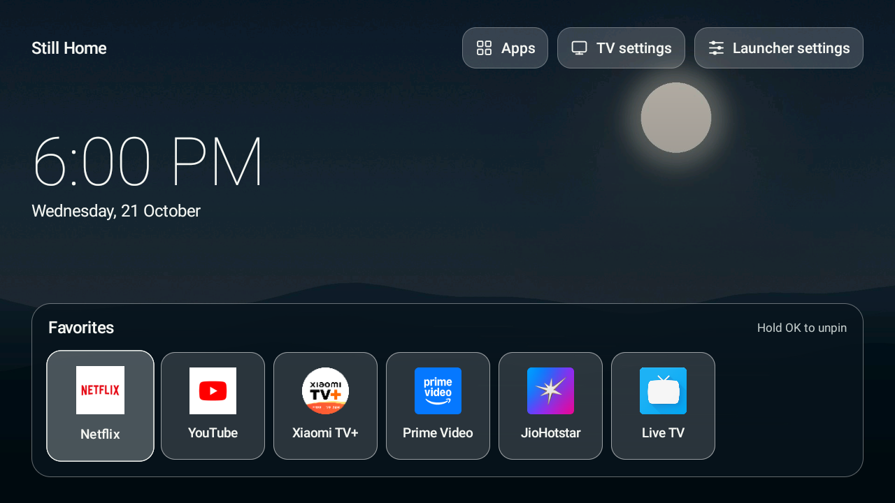

# Still Home

A small, MIT-licensed Android TV launcher built for a Redmi `MiTV-AXFR0`. It has one remote-friendly favorites shelf, a full installed-app grid, personal wallpapers, a system screensaver, and honest maintenance shortcuts. The app has **no network permission, ads, analytics, or external runtime libraries**.



The chosen layout follows [Horizon shelf](design/mockups/01_horizon_shelf.png). The [contact sheet](design/mockups/00_contact_sheet.png) also contains [Stone grid](design/mockups/02_stone_grid.png), [Night strip](design/mockups/03_night_strip.png), and [screensaver](design/mockups/04_stillwater_screensaver.png) studies.

## What works

- Launch TV apps discovered through Android's Leanback launcher category, with ordinary launchable apps as fallback. Netflix, YouTube, and Xiaomi TV+ are explicitly visible to package queries on Android 11+.
- Open **TV settings** for the device's Network, Wi-Fi, Ethernet, and other Android settings; the separate **Launcher settings** action controls Still Home. The top actions have distinct grid, display, and sliders icons with short labels.
- Pin or unpin favorites by holding OK on a tile. The shelf scrolls horizontally with the remote.
- Choose one of three bundled backgrounds or send a personal photo from the Mac over ADB. Images decode off the UI thread at a bounded size.
- Preview the clock screensaver and select it through Android's secure screensaver setting.
- See storage and memory information, open system storage settings, and open each app's Android App info screen. “Clear launcher cache” only clears Still Home's own cache.

## Verified on this TV

The debug APK was built and installed over the local network. ADB remote key events opened and scrolled the app grid, pinned and unpinned a favorite, opened Netflix, YouTube, and Xiaomi TV+, and returned to Still Home with the Home key. The new TV settings action opened Android TV Settings, whose Network & Internet screen exposed Wi-Fi choices and whose home screen showed Ethernet status. The separate Launcher settings action opened Still Home's own preferences, and Back returned to Home with toolbar focus preserved. Built-in wallpaper changes, transfer and removal of a Mac photo, screensaver preview and selection, maintenance links, and the original-Home rollback were also exercised. The screensaver's natural idle trigger remains controlled by the TV firmware and has not been timed.

The installed version 0.1.1 debug APK is 213,153 bytes. Two earlier `dumpsys meminfo` readings with Home open showed 52,950–66,537 kB total PSS. In one 12-key ADB navigation run after app loading, `gfxinfo` reported a 14 ms median frame time and one missed frame deadline across 30 frames. These small samples are not a comparison with the stock launcher or a real-world FPS guarantee; ADB input injection itself was reported as high latency.

## Build

Requirements: JDK 17 and Android SDK Platform 35 + Build Tools 35.0.0. On this Mac the SDK is in `~/Library/Android/sdk`.

```sh
export ANDROID_HOME="$HOME/Library/Android/sdk"
./gradlew assembleDebug
```

The APK is `app/build/outputs/apk/debug/app-debug.apk`. It is a personal test build signed by this Mac's Android debug key. Keep that key for future updates to the same installed app, or uninstall before reinstalling with a different key.

## Install on this TV

The TV was discovered at `192.168.1.7` on 21 October 2026. Its IP may change. Enable Xiaomi's ADB debug option and accept the Mac's authorization prompt on the TV. Then:

```sh
~/Library/Android/sdk/platform-tools/adb connect 192.168.1.7:5555
~/Library/Android/sdk/platform-tools/adb -s 192.168.1.7:5555 install -r app/build/outputs/apk/debug/app-debug.apk
~/Library/Android/sdk/platform-tools/adb -s 192.168.1.7:5555 shell am start -n dev.stillhome.tv/.HomeActivity
```

Open Netflix, YouTube and Xiaomi TV+ from Still Home first. On this Redmi firmware, selecting the Home role alone still leaves Google's launcher in control of the Home key: its system intent filter has a higher priority. This TV also blocks disabling only Google's Home activity, so finish setup from the Mac with both commands:

```sh
~/Library/Android/sdk/platform-tools/adb -s 192.168.1.7:5555 shell cmd package set-home-activity --user 0 dev.stillhome.tv/.HomeActivity
~/Library/Android/sdk/platform-tools/adb -s 192.168.1.7:5555 shell pm disable-user --user 0 com.google.android.tvlauncher
~/Library/Android/sdk/platform-tools/adb -s 192.168.1.7:5555 shell input keyevent 3
```

The TV's original Home component, recorded before installation, is `com.google.android.tvlauncher/com.google.android.tvlauncher.MainActivity`. The Google TV launcher package remains installed and can be restored. To roll back **before uninstalling Still Home**:

```sh
~/Library/Android/sdk/platform-tools/adb -s 192.168.1.7:5555 shell pm enable --user 0 com.google.android.tvlauncher
~/Library/Android/sdk/platform-tools/adb -s 192.168.1.7:5555 shell cmd package set-home-activity --user 0 com.google.android.tvlauncher/com.google.android.tvlauncher.MainActivity
~/Library/Android/sdk/platform-tools/adb -s 192.168.1.7:5555 shell input keyevent 3
```

The package-level change is reversible and was required only because of this firmware's intent priority. Google TV launcher features inside that package are unavailable while it is disabled; Android Settings, the streaming apps tested here, and Xiaomi TV+ stayed available in device tests. If a TV update re-enables the package, repeat the two setup commands. Leave `com.mitv.tvhome.mitvplus` enabled so Xiaomi TV+ continues to work.

## Send your own wallpaper

On the TV, open **Launcher settings → Built-in wallpapers** to choose Horizon, Stone, or Night. This Redmi firmware only exposes a stub for Android's document picker. Send a JPEG, PNG, or WebP image (up to 15 MiB) from the Mac:

```sh
python3 scripts/send_wallpaper.py ~/Pictures/my-wallpaper.jpg
```

The script validates the complete image with macOS `sips`, copies it into Still Home's private storage through authenticated ADB, and confirms that the TV selected it. Its filename remains recognizable in **Launcher settings → Photos from Mac**. Up to 12 photos can be kept; hold OK on one there to remove it. The transfer uses Android's `run-as`, which works with the **debug APK built by this project**. If the TV's IP changes, reconnect ADB and pass `--serial NEW_IP:5555`. The image stays local to the TV; Still Home has no network permission.

## Select the screensaver

The TV has no working Android screensaver selection page. First use **Launcher settings → Preview** in Still Home to inspect it. Then select the registered service with the helper:

```sh
python3 scripts/configure_screensaver.py status
python3 scripts/configure_screensaver.py setup
python3 scripts/configure_screensaver.py status
```

Setup saves the TV's original `screensaver_components` and enabled state in `.local/screensaver-backup.json`, then selects Still Home's `DreamService`. The backup is local and excluded from Git. To restore the original screensaver:

```sh
python3 scripts/configure_screensaver.py rollback
```

Rollback checks that the TV still has Still Home selected. If you changed the screensaver yourself afterward and still want to restore the backed-up choice, use `rollback --force`. The backup is tied to this TV's Android ID so it cannot be applied to a different device. Use `--serial NEW_IP:5555` with these commands if the TV address changes. The TV controls when the screensaver starts; selecting the service does not change the idle delay.

## Source map

- `HomeActivity`: HOME screen, app grid, remote focus, favorites.
- `AppCatalog`: package visibility, Leanback discovery and app launching.
- `WallpaperStore` / `BackdropLayout`: built-in and personal wallpaper loading.
- `StillDreamService`: Android-managed screensaver.
- `MaintenanceActivity`: device stats and system App info links.
- `LauncherPrefs`: local favorites, palette and image URI.

See [research and implementation plan](docs/RESEARCH_AND_PLAN.md) for device facts, limits and design decisions.
